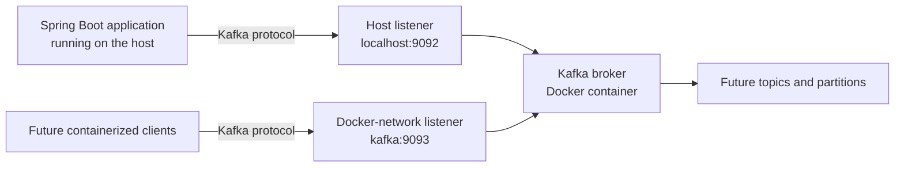

# Kafka Mini Project — Feature Log

This document records the project architecture and requirements feature by feature. New approved features should be appended as the next numbered feature.

## Feature 1 — Project Setup

### Feature 1.2 — Kafka Infrastructure

#### Step 1 — Architecture and Requirements Review

**Status:** Architecture proposed; prerequisites and implementation are not yet verified.

##### Proposed architecture

The Spring Boot application runs locally on the host computer. Kafka runs separately in a Docker container, managed by Docker Compose. The application will connect to Kafka through a host-accessible listener. A second listener on the Docker network can support future clients running in containers.



##### Components and communication

- **Spring Boot application:** The Java application that will later send or receive events. The Kafka server runs separately from this process.
- **Producer:** A client that sends records, commonly called events, to Kafka. Producer implementation is out of scope for this feature.
- **Broker:** The Kafka server that accepts, stores, and serves records.
- **Topic:** A named stream of records. Topic creation and configuration are deferred to a later feature.
- **Partition:** An ordered log within a topic. Partitions allow distribution and parallel work; ordering is guaranteed within a partition, not across every partition in a topic.
- **Consumer:** A client that reads records. Consumer implementation is deferred to a later feature.
- **Docker image:** A packaged template for running software, such as Kafka.
- **Container:** A running instance of an image.
- **Docker Compose:** A way to describe and manage the Kafka container and its settings, including ports, storage, and readiness checks.

The intended local flow is: Docker Compose starts Kafka; Kafka becomes ready; the locally running Spring Boot application connects to the broker using a host-accessible address. Future containers can connect over the Docker network.

##### Listener and advertised-listener considerations

A **listener** is an address and port on which Kafka accepts client connections. An **advertised listener** is the address Kafka tells clients to use after they connect. These addresses may differ because `localhost` on the host computer refers to the host, while `localhost` inside a container refers to that container.

The host application needs a host-reachable listener, typically `localhost` on a published port. Containerized clients need a Docker-network address, typically the Kafka Compose service name and an internal port. Incorrect advertised addresses can allow an initial connection but cause later client requests to fail. Listener settings must be verified from each type of client that the project intends to support.

##### Deployment recommendation and limitations

Use one Kafka broker for local learning. It is simpler to run and troubleshoot, but is not highly available. If it stops, Kafka is unavailable; a single broker cannot demonstrate multi-broker failover or meaningful replication.

Use Kafka's **KRaft** mode, which manages cluster metadata without a separate ZooKeeper service. Prefer an official Apache Kafka image with a pinned version rather than a moving `latest` tag. Choose the exact image version only after checking image availability and compatibility with the project's resolved Kafka client and Java versions.

##### Requirements and acceptance criteria

1. Compose starts one Kafka broker without a separate ZooKeeper container.
2. The host-published Kafka port is bound only to the local machine, not all network interfaces.
3. Readiness is checked with a Kafka-aware health check or equivalent protocol check; container startup alone is insufficient.
4. A documented check verifies broker connectivity through the intended host address and port.
5. The broker can be stopped and started with Docker Compose.
6. Documentation explains whether broker data persists and how to clean it up.
7. The Kafka image version is pinned, and compatibility with the project's Java and resolved Kafka client version is recorded.
8. No producer, consumer, topic, REST endpoint, or application Kafka configuration is added in this feature.

##### Prerequisites to verify

Do not assume these checks have passed. Run them from PowerShell in the project directory before implementation:

```powershell
docker --version
docker compose version
docker info
java -version
.\mvnw.cmd -version
git branch --show-current
git status --short
```

Check whether likely host ports are already occupied:

```powershell
Get-NetTCPConnection -State Listen |
  Where-Object { $_.LocalPort -in 9092, 9093 }
```

The branch, worktree status, installed Docker tools, available ports, and resolved dependency compatibility all require fresh verification before implementation.

##### Proposed files and responsibilities

- **`compose.yaml`:** Define the pinned Kafka image, KRaft settings, loopback-only host port binding, storage policy, and readiness check.
- **`Readme.Md`:** Document prerequisites, start/stop commands, readiness checks, and the data-retention and cleanup policy. Extend the existing README rather than creating a duplicate.
- **`.gitignore`:** Change only if implementation creates local artifacts that should not be committed.
- **`pom.xml` and application properties:** Inspect to establish compatibility, but do not add application Kafka configuration or dependencies unless a verified need requires it.

##### Validation and failure diagnosis

1. Check prerequisites, branch, worktree, and port conflicts.
2. Validate Compose syntax with `docker compose config`.
3. Start Kafka and inspect container state, health status, and logs.
4. Verify readiness with a Kafka protocol-aware check, not only a TCP port probe.
5. Test the host listener and confirm Kafka advertises an address the host client can reach.
6. Stop and restart the service; check that data behavior matches the documented storage policy.
7. If startup or connectivity fails, inspect Compose status and broker logs, then check port conflicts, KRaft settings, and listener/advertised-listener addresses.

A TCP check such as `Test-NetConnection localhost -Port 9092` only confirms that a port accepts a connection; it does not establish Kafka protocol readiness or correct advertised addresses.

##### Risks, limitations, and scope

- Bind the host port to `127.0.0.1` and do not expose this unauthenticated local-development broker to other machines or the public internet.
- Pin image versions for reproducibility; update them deliberately.
- A running container is not necessarily a ready broker.
- Container removal and volume removal are different operations; document persistence and avoid deleting volumes unintentionally.
- Check compatibility against actual resolved dependencies rather than inferring it from the Java version setting alone.
- This feature covers local Kafka infrastructure and its documentation only. Producers, consumers, topics, event REST APIs, and application Kafka configuration belong to later features.

##### Implementation plan after review

1. Verify Docker/Compose, Java/Maven, ports, branch, and worktree.
2. Inspect the resolved Kafka client version and choose a compatible pinned official Kafka image.
3. Confirm listener addresses, host port binding, and data-retention policy.
4. Add the Kafka Compose service and readiness check.
5. Validate and start the service; verify readiness and host connectivity.
6. Document operation and cleanup in the existing README.
7. Review the result against the acceptance criteria.

**Next action:** Review and approve this architecture and its acceptance criteria. After approval, verify the prerequisites before moving to implementation planning.
